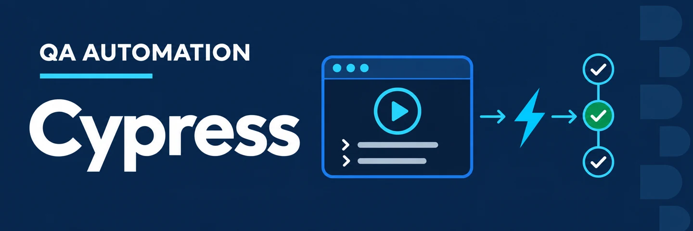
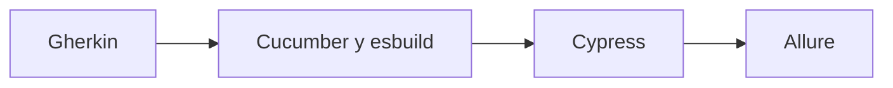

# Cypress + Cucumber + Allure

Pruebas web E2E en TypeScript con escenarios Gherkin en español. Puedes depurar un escenario en el runner interactivo de Cypress y consultar sus evidencias en Allure.

[Inicio rápido](#inicio-rápido) · [Flujo de prueba](#flujo-de-prueba) · [QA asistido por IA](#qa-asistido-por-ia) · [GitHub Actions](https://github.com/Jlaucel/TS--Cypress-Cucumber/actions/workflows/qa.yml)

## Qué incluye

- **BDD en el navegador.** El preprocesador de Cucumber enlaza los escenarios Gherkin con pasos TypeScript. esbuild prepara esos pasos para el runner.
- **Ejecución interactiva.** Abre Cypress para seleccionar un escenario, inspeccionar sus comandos y depurar sus aserciones.
- **Reportes Allure.** Consulta estados, tiempos y evidencias de la ejecución.

## Inicio rápido

Usa Node.js 24. Para abrir el reporte Allure, instala Java y configura `JAVA_HOME`.

```bash
npm ci
npm run qa:check
npm test
```

Para abrir el runner interactivo, ejecuta `npm run cypress:open`. Para consultar los resultados de la última ejecución, usa `npm run report`.

## Flujo de prueba



El escenario `QA-CYP-001` realiza una búsqueda y verifica que aparezcan los resultados. Tiene la etiqueta `@external` porque depende de la respuesta de Google. El workflow de CI valida Gherkin y trazabilidad. [Ver los escenarios](cypress/e2e/google_search.feature)

| Ruta | Contenido |
| --- | --- |
| [`cypress/e2e/`](cypress/e2e/) | Escenarios Gherkin. |
| [`cypress/support/step_definitions/`](cypress/support/step_definitions/) | Pasos en TypeScript y hooks de Cucumber. |
| [`cypress.config.ts`](cypress.config.ts) | Configuración del runner, esbuild y Allure. |

## QA asistido por IA

| Skill de Codex | Cuándo usarla |
| --- | --- |
| [`$qa-design`](.agents/skills/qa-design/SKILL.md) | Diseñar escenarios BDD según criterios de aceptación y riesgo. |
| [`$qa-triage`](.agents/skills/qa-triage/SKILL.md) | Preparar un diagnóstico con los resultados y la evidencia de una ejecución. |
| [`$qa-integrations`](.agents/skills/qa-integrations/SKILL.md) | Relacionar diseños, criterios y casos con sus pruebas. |

`npm run qa:triage` resume los resultados Allure después de una ejecución. Los hooks de Codex orientan el flujo de diseño y diagnóstico. [Guía ISTQB y hooks](docs/qa.md)

Configura **Figma, Jira, Zephyr y Slack** en tu cliente local con acceso autorizado. [Guía de conexiones](docs/integraciones-qa.md)

---

**Colección QA Automation de Yunior Laucel**

**Cypress** · [Playwright](https://github.com/Jlaucel/TS-Playwrigth-Cucumber) · [WebdriverIO](https://github.com/Jlaucel/TS-WebdriverIO-Cucumber) · [Maestro](https://github.com/Jlaucel/TS-Maestro-Cucumber) · [yuniorlaucel.com](https://yuniorlaucel.com)
